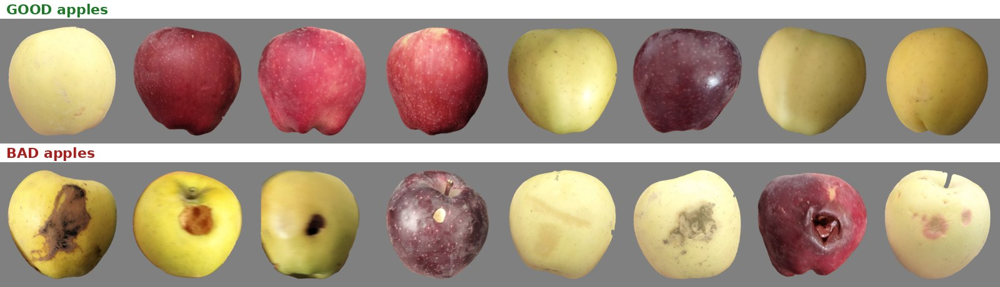
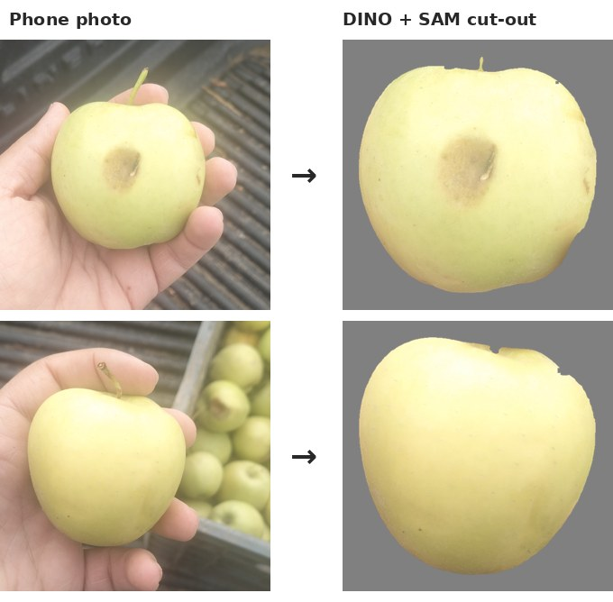
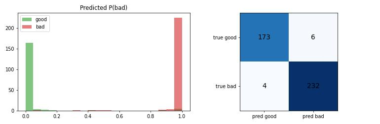

# Apple Quality Classifier: good vs bad apples from phone photos

An end-to-end computer-vision pipeline that grades apples as **good** or **bad** (rot, bruise, scab, hole). I collected and labeled my own dataset, built the labeling tool, removed backgrounds with Grounding DINO + SAM, and trained a ConvNeXt-Tiny ensemble with leakage-safe cross-validation.

**97.6 % out-of-fold accuracy on 415 self-collected photos · 98.3 % of bad apples caught · 33 ms per apple on a laptop GPU**



---

## Pipeline

```
 phone photos ──► labeling tool ──► Grounding DINO + SAM ──► ConvNeXt-Tiny ──► P(bad)
 (realme 12,      (Flask, keyboard   (keep the held apple,     (5-fold grouped CV,
  apple held       driven, 2 passes)  remove hand + crate)      EMA, flip-TTA ensemble)
  in hand)
```

| Step | What I did | Code |
|---|---|---|
| **1. Data collection** | Photographed 415 apples held in one hand in front of a crate, under normal and dim light. Red, green and yellow varieties. | (photos) |
| **2. Labeling** | Built a keyboard-driven Flask labeling app (good/bad + defect type + quality flags, undo, zoom, queue filters) to label hundreds of photos quickly. | [`labeler/`](labeler/) |
| **3. Background removal** | Grounding DINO finds the largest apple (the held one). SAM segments it, and the hand mask is subtracted only in the outer rim, so defects at the edge are never cut off. Suspicious masks are flagged for review, not silently dropped. | [`segmentation/`](segmentation/) |
| **4. Training** | ConvNeXt-Tiny (ImageNet-pretrained), 384 px, 30 epochs, AdamW, label smoothing, EMA weights, background and lighting augmentation, balanced sampling across variety × lighting × label. | [`training/`](training/) |
| **5. Inference** | 5-fold ensemble with flip test-time augmentation, or a fast single-model mode for real-time use. | [`inference/`](inference/) |



## Evaluation: why the number is honest
A small dataset makes it easy to fool yourself, so the evaluation is built to prevent that:

- **Grouped folds.** Several photos of the *same apple* are linked (by capture time plus embedding similarity) and always land in the same fold. The model is never validated on an apple it saw in training.
- **Leakage audit.** For every validation photo, the notebook checks that its nearest training photo is not a near-duplicate.
- **Shortcut probes.** Simple classifiers trained only on variety or capture statistics (brightness, colour, sharpness) measure how much a model could "cheat" without looking at defects.
- **Out-of-fold predictions.** Every photo is scored by the model that did *not* train on it.

**Result (out-of-fold, 415 photos):**

| | predicted good | predicted bad |
|---|---|---|
| **true good** (179) | 173 | 6 |
| **true bad** (236) | 4 | 232 |

- **Accuracy 97.6 %** (405 / 415)
- **Bad apples caught: 98.3 %**, good apples kept: 96.6 %



## Speed (NVIDIA GTX 1650 Max-Q laptop GPU, fp32)

| Mode | Latency per apple | Throughput |
|---|---|---|
| Full ensemble: 5 models × 4 flip views | 573 ms | 1.7 apples/s |
| 1 model × 4 flip views | 115 ms | 8.7 apples/s |
| **1 model, 1 view (`--fast`)** | **33 ms** | **30 apples/s** |

Half precision turned out to be **3× slower** than fp32 on this GPU (GTX 16xx cards have no tensor cores), so fp16 is opt-in.

## Quick start

```bash
pip install torch timm opencv-python-headless pillow scipy numpy
# download convnext_fold0..4.pt from the Releases page into models/
python inference/predict.py samples/bad/bad_00.png samples/good/good_00.png
python inference/predict.py --fast samples/bad/*.png          # real-time mode
python inference/benchmark.py samples --models models         # measure speed
```

Input is a background-removed apple (RGBA PNG) or an apple on a neutral gray background, the same format the segmentation step produces.

## Repository layout
```
labeler/        Flask labeling app + export script + tests
segmentation/   Grounding DINO + SAM background removal (Kaggle notebook + local script)
training/       full training & evaluation notebook (Kaggle GPU)
inference/      predict.py (ensemble / fast mode), benchmark.py
data/labels.csv labels for all photos (good/bad, variety, lighting, defect)
samples/        16 example cut-outs
results/        confusion matrix, figures
```

**Downloads (Releases):** the 5 model weight files and the full cut-out dataset (415 RGBA images + labels).

## Next steps
- Second-stage model for the **defect type** (rot, bruise, scab, hole).
- Integrate the classifier into a ROS 2 sorting cell, where a gantry robot picks each apple and places it by grade.

## Author
**Saadna Ilyes**, final-year Industrial Networks & AI engineering student (HNSREED, Algeria) ·
[LinkedIn](https://linkedin.com/in/ilyes-saadna) · ilyessaadna4@gmail.com

Code: MIT License · Dataset images: CC BY 4.0
